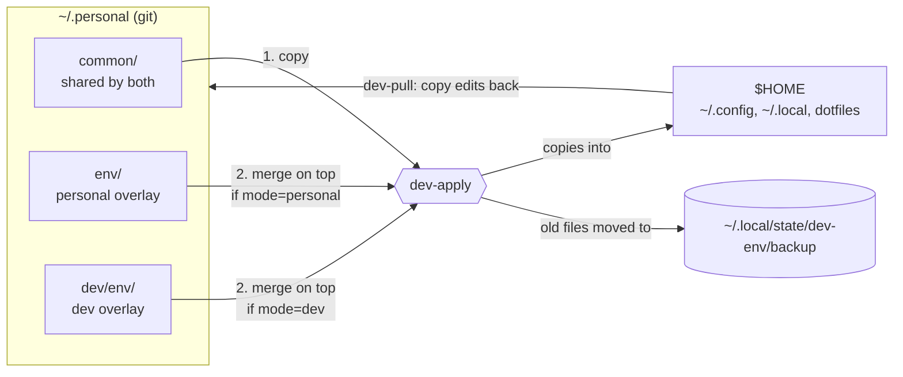
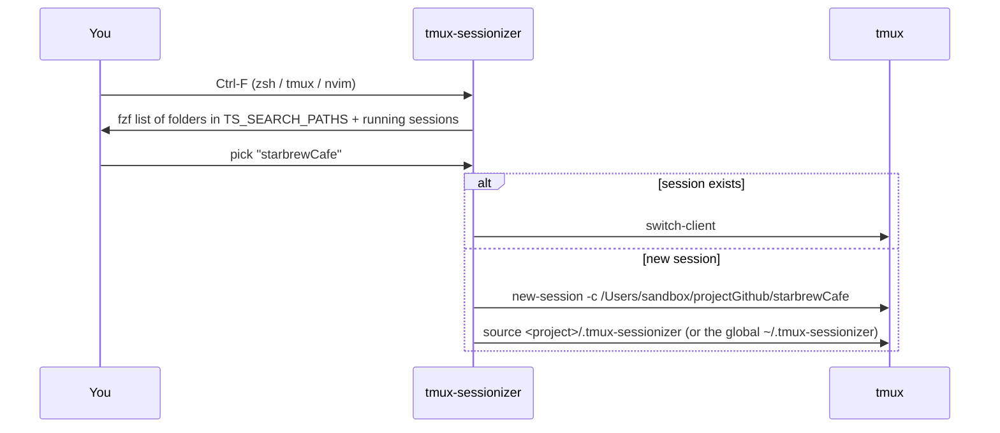

# .personal: the complete guide

The end-to-end guide to my macOS dev environment: what it is, why it's built this way, how every
part works, and where it's going. Read it as a website at [meettak.github.io/primeageMultiEnvSetup](https://meettak.github.io/primeageMultiEnvSetup/)
(sidebar, search, dark mode), or right here on GitHub. The short project overview is [`README.md`](https://github.com/MeetTak/primeageMultiEnvSetup/blob/main/README.md).

Modelled on ThePrimeagen's [dev](https://github.com/ThePrimeagen/dev),
[init.lua](https://github.com/ThePrimeagen/init.lua) and
[tmux-sessionizer](https://github.com/ThePrimeagen/tmux-sessionizer).

- **Part I: Story and specs.** Goals, requirements, design decisions and their reasons, how this
  differs from Primeagen's setup, the build history, and the ideas backlog.
- **Part II: Reference.** Quick start, architecture, every command, keymaps, recipes, troubleshooting.

> **Keeping this current:** every change to the project updates this guide and `README.md` in the
> same change (a rule in the local, untracked `CLAUDE.md`). `tests/run` fails if a command, install script or project session
> is missing from this guide.

---

### Contents

**Part I: Story and specs**

- [A. Goals](#a-goals)
- [B. Specs: the rules the project keeps](#b-specs-the-rules-the-project-keeps)
- [C. Design decisions (and why)](#c-design-decisions-and-why)
- [D. Compared with ThePrimeagen's setup](#d-compared-with-theprimeagens-setup)
- [E. Build history](#e-build-history)
- [F. Ideas and roadmap](#f-ideas-and-roadmap)

**Part II: Reference**

1. [Quick start (new Mac)](#1-quick-start-new-mac)
2. [The mental model](#2-the-mental-model)
3. [Repository layout](#3-repository-layout)
4. [Daily workflow](#4-daily-workflow)
5. [Command reference](#5-command-reference)
6. [How `dev-apply` works](#6-how-dev-apply-works)
7. [How `dev-pull` works](#7-how-dev-pull-works)
8. [The shell: load order, PATH, lazy loading](#8-the-shell-load-order-path-lazy-loading)
9. [tmux and tmux-sessionizer](#9-tmux-and-tmux-sessionizer)
10. [Neovim](#10-neovim)
11. [Keyboard and window management](#11-keyboard-and-window-management)
12. [Other app configs](#12-other-app-configs)
13. [Secrets and privacy (public repo)](#13-secrets-and-privacy-public-repo)
14. [Docker: Pi first, Mac fallback](#14-docker-pi-first-mac-fallback)
15. [Tests](#15-tests)
16. [Recipes](#16-recipes)
17. [Troubleshooting](#17-troubleshooting)
18. [Known quirks](#18-known-quirks)

---

## Part I: Story and specs

### A. Goals

1. **Rebuild a Mac from scratch** with a handful of commands (`./init`, `./run …`, `dev-apply`).
2. **Two profiles:** a minimal *personal* setup and a full *dev* toolchain, switchable at any time with one command.
3. **Keyboard-driven work, Primeagen-style:** tmux + Neovim + tiling windows. `Ctrl-F` jumps to any
   project from zsh, tmux or nvim, and every project opens with its editor, servers and tests already running.
4. **Safe to use:** nothing is ever deleted, every change can be previewed with `--dry`, and a test suite checks the scripts.
5. **Fast:** a new shell starts in about 0.1 s.
6. **Shareable:** the repo is public, so it holds no secrets or identity.

### B. Specs: the rules the project keeps

These are the requirements every change must keep. Most are enforced by `tests/run`.

| # | Rule | Enforced by |
|---|---|---|
| S1 | The repo path is defined once (`DEV_ENV_ROOT`, default `~/.personal`); scripts never hard-code it elsewhere. | review |
| S2 | Anything identical between profiles lives in `common/`; overlays hold only real differences. | review |
| S3 | `dev-apply` never deletes: everything it replaces goes into a unique, timestamped backup (10 kept). | `test_apply_backs_up_*`, `test_apply_twice_same_second_*`, `test_apply_prunes_*` |
| S4 | `dev-apply` only touches top-level folders and files the repo contains. | `test_apply_backs_up_and_keeps_unmanaged` |
| S5 | `--dry` changes nothing, for `dev-apply`, `dev-pull` and `run`. | `test_apply_dry_*`, `test_pull_copies_*`, `test_run_*` |
| S6 | `dev-pull` copies a live edit back into the tree that owns the file, and never adds files on its own. | `test_pull_*` |
| S7 | Every `runs/` script is idempotent (safe to run twice). | review, `test_runs_*` |
| S8 | No secrets, API keys, private keys or email addresses in the repo. Identity lives in `~/.gitconfig.local`, secrets in `~/.secrets` (`600`). | `test_no_identity_in_repo`, `test_runs_git_*` |
| S9 | The dev shell starts in under 0.3 s: nvm, conda and sdkman stay lazy-loaded. | `test_dev_shell_lazy_loads`, `time zsh -l -i -c exit` |
| S10 | A command installed by `dev-apply` must not be shadowed by an older copy on PATH (a warning is printed). | `test_apply_warns_on_shadowed_command` |
| S11 | Tests never touch the real `$HOME` or the real repo. | the test harness (`setup`, `in_home`) |
| S12 | Docs stay current: `README.md` and this guide are updated in every change that alters behaviour. | `test_docs_cover_*`, local `CLAUDE.md` |
| S13 | The docs site builds with `mkdocs build --strict` (no broken links or anchors), and the Markdown renders the same on GitHub and on the site. | GitHub Action, `test_docs_site_builds_strict`, `test_docs_markdown_renders_on_site` |

### C. Design decisions (and why)

| Decision | Why | What we didn't do |
|---|---|---|
| **Copy files, don't symlink** | Same model as Primeagen's `dev-env`. The live system can't be broken by editing the repo half-way, and `--dry` can show exactly what will change. | GNU stow or symlinks: an edit applies instantly, but there's no preview and no backup. |
| **`common/` + overlay** instead of two full trees | The original setup had two copies of the same files (skhd, yabai, dev-* scripts), and they drifted apart. | Keeping a full tree per profile. |
| **Move to a backup instead of `rm -rf`** | The original `dev-apply` deleted the live folder first. A backup makes every apply reversible. | — |
| **Unique backup folder per run** (`<time>-<pid>`) | Found while writing the tests: two applies in the same second shared a folder, and the second could overwrite the backup of your *original* file. | Second-resolution names only. |
| **`dev-pull` diffs, then copies into the owning tree** | The old version copied folders back blindly, so caches and app-written junk ended up in the repo. | Auto-adding new live files. |
| **PATH shadow warning in `dev-apply`** | A real bug: an old February `dev-apply` in `~/.local/bin` ran instead of the new one (`DEV_ENV_HOME must be set`). | — |
| **tmux-sessionizer as a git submodule** | It's Primeagen's maintained script; we take his updates and change only its config. | Writing our own picker. |
| **`run_in` for project sessions, not `tmux send-keys`** | Tested: keys sent to a brand-new window were sometimes lost before zsh was ready, so `npm run dev` never started. `run_in` starts the command in the window's own shell, and you drop back to a shell after Ctrl-C. | `send-keys` (Primeagen's style), which works on his Linux machine but raced here. |
| **Per-project hydrate files live in the dotfiles repo** (`projects/`) and are copied in by `./run projects` | They're versioned in one place, and a global git ignore keeps the project repos clean. | Committing them into each project repo. |
| **Lazy-load nvm, conda, sdkman** | Measured: conda init took ~650 ms and nvm.sh ~510 ms, out of 0.76 s total. The default node's `bin` goes straight onto PATH, so tools still work instantly. Startup is now 0.09 s. | Dropping the tools (`n` is set up as nvm's eventual replacement). |
| **`~/.gitconfig.local` for `[user]`** | The repo is public and `.gitconfig` held your email. | Committing `.gitconfig` as it was. |
| **Hammerspoon stays in its own repo** | `~/.hammerspoon` is already a git repo (`hammerspoonConfig`) with its own secrets; `~/.config/hammerspoon` was an unused old copy. | Copying it into `common/`. |
| **sketchybar skipped** | Its folder was empty and it isn't installed. | — |
| **Lua Neovim on nvim 0.12 APIs** | `vim.lsp.config`/`vim.lsp.enable` + mason-lspconfig automatic enable; treesitter on the `main` branch (same as Primeagen today). | The older lspconfig `setup{}` handlers. |
| **Mason servers installed by `runs/neovim`** | mason-lspconfig deliberately skips `ensure_installed` in headless nvim, which the scripts use. | Relying on the first interactive start. |
| **Tests use a repo copy + fake `$HOME`, and `fail` exits the test** | A first version reported passes for failing tests (bash ignores `set -e` inside `if`/`||`). After the fix, a check with three injected bugs failed 9 tests. | Asserting with `return 1`. |
| **Docs site: MkDocs Material on GitHub Pages, built by a GitHub Action** | It's built from `docs/GUIDE.md` itself, so it never drifts. Every push redeploys it. You get sidebar, search, dark mode and Mermaid diagrams, and the repo is already public. `--strict` makes broken links fail the deploy. | Plain Jekyll Pages (no Mermaid, sidebar or search); a hand-made HTML page (goes stale); a private claude.ai page (a snapshot). |
| **One page per guide, Part I/II as `##` headings** | Material's outline only lists the children of the first `#` heading, so `#` Part headings hid every section from the outline. | Splitting the guide into many pages, which would break the GitHub-readable single file and every `#anchor` link. |
| **The secret check looks for real email addresses and key values** | Its first pattern flagged the shell variable `email="$(git config …)"`. | Keyword-only matching. |

### D. Compared with ThePrimeagen's setup

| Area | Primeagen ([dev](https://github.com/ThePrimeagen/dev) / [init.lua](https://github.com/ThePrimeagen/init.lua)) | This repo | Reason |
|---|---|---|---|
| Installer | `dev-env`: `rm -rf` + copy | `dev-apply`: backup + copy, `common/` + 2 profiles, shadow warning | Safety, two profiles |
| Machine setup | `run` + `runs/` with pacman/paru | `run` + `runs/` with Homebrew + `Brewfile` | macOS (also: macOS `find` has no `-executable`) |
| Repo location | `~/personal/dev`; projects under `~/personal` | `~/.personal`; projects under `/Users/sandbox/projectGithub` | Your layout |
| Sessionizer | submodule → `~/.local/scripts` | submodule → `~/.local/dev-bin` | Same idea |
| Session commands | `opencode`, `image-request` | `claude` (Alt-h), `lazygit` (Alt-t) | Your tools |
| Hydrate | global `~/.tmux-sessionizer` | global + per-project (`projects/`) with `run_in` | Servers and tests per project |
| tmux | prefix `C-a`, vi copy with `xclip` | prefix `C-a`, vi copy with `pbcopy`, plus your plugins (resurrect, continuum, dracula), lazygit popup | macOS clipboard |
| Neovim | namespace `theprimeagen`; harpoon from a local clone, `Alt-1..4` | namespace `meet`; harpoon2 from GitHub, `Alt-1..4` **and** `<leader>1..4` | No local plugin clones needed |
| Neovim extras | Go snippets, `99` AI plugin, cellular-automaton, vim-with-me | left out | Not part of your workflow |
| Keyboard | Dvorak remaps | QWERTY; Karabiner Caps Lock = Hyper | Your keyboard |
| Window manager | i3 / Hyprland | yabai + skhd | macOS |
| Shell | oh-my-zsh | plain zsh + Powerlevel10k, lazy-loaded toolchains | Startup speed |
| Commit helper | `dev-commit` across 3 repos, fixed message | `dev-commit`, one repo, dated message, no-op when clean | Single repo |

### E. Build history

| Phase | What happened |
|---|---|
| **0: Initial setup** | `~/personal` with `env/` (personal) and `dev/` (dev) as full copies, `dev-apply` (rm + copy), `dev-on/off/status/pull`. Problems found in review: duplicated files, a destructive apply, a `DEV_ENV_HOME` pointing at the wrong profile in `env/.zprofile`, aliases loaded twice, dead PATH entries. |
| **1: Primeagen layout** | Renamed to `~/.personal` with `DEV_ENV_ROOT`. Added `common/` + overlays, one backup-based `dev-apply`, a diff-based `dev-pull`, `run` + `runs/`, `Brewfile`, tmux on XDG with Primeagen's binds, the tmux-sessionizer submodule, a lua Neovim config (replacing a 31-line `init.vim`), `dev-commit` and `todo.md`. Also fixed the `javafx_run` alias, which had only worked because of the double loading. |
| **2: todo round** | Tracked ghostty, starship, lazygit, karabiner and git configs; split git identity into `~/.gitconfig.local`; added `runs/hammerspoon`; pointed the sessionizer at `projectGithub`; added per-project sessions (starbrewCafe, tenderScout) and switched to `run_in` after the send-keys race; lazy-loaded nvm/conda/sdkman (0.76 s → 0.09 s); added `watchexec`. |
| **3: Hardening** | Fixed the stale `~/.local/bin/dev-*` scripts (the `DEV_ENV_HOME` error); added the PATH shadow warning and unique backup folders; built `tests/run` (fixed its `set -e` pitfalls, then checked it with injected bugs); audited the public repo for secrets; `runs/git` now forces `~/.secrets` to `600`. |
| **4: Docs** | `README.md` (project overview) + this guide, docs-coverage tests, and the rule in `CLAUDE.md` that every change updates both. |
| **5: Docs website** | MkDocs Material site (`mkdocs.yml`, `docs/index.md`) published to GitHub Pages by `.github/workflows/docs.yml`. Fixed two site-only rendering problems found by screenshotting the local build: the `#` Part headings hid the outline, and lists glued to a text line rendered as run-on paragraphs. Added tests for both, and for the strict build. |
| **6: Public-repo cleanup** | `CLAUDE.md`, `todo.md` and `.DS_Store` became local-only (git-ignored) and the history was squashed into one fresh commit, so none of them is in any commit on GitHub. The username in `env/vscode/settings.json` was replaced with `$HOME`. |

### F. Ideas and roadmap

**Open** (also tracked in the local, git-ignored `~/.personal/todo.md`, opened with tmux `prefix D`):

- [ ] Prune the `Brewfile`: it was seeded from `brew bundle dump` (71 formulas, 10 casks, 8 App Store apps).
- [ ] Ghostty: move `reload_config` off `Ctrl-R` so zsh/fzf history search works again.
- [ ] Dev profile: drop either starship or Powerlevel10k (p10k wins today; starship only costs startup time).
- [ ] More project sessions: `db_app` (JavaFX, `./mvnw javafx:run`), `flowQ`, `medilink_hacknite` (Maven + `watchexec -e java -- mvn -q test`).
- [ ] Practise with `:VimBeGood`.
- [ ] Before **May 2027**: move the docs site from Material for MkDocs (end of life on May 5, 2027) to its successor **Zensical**, which reads the same `mkdocs.yml`.

**Ideas from Primeagen's setup, not built yet:**

- Keep the Neovim config in its own repo as a submodule (his `init.lua` pattern), so it can be shared on its own.
- A `cht.sh` popup in tmux (`prefix i`) for quick language/command cheat sheets.
- Git worktree helpers for working on several branches at once.
- Load secrets from a password-manager CLI (1Password `op` / `pass`) instead of a plain `~/.secrets` file.
- Replace nvm with `n` completely (`./run node` already installs it; `N_PREFIX` is set).
- Use your GitHub noreply address in `~/.gitconfig.local` so new commits don't show your email.

**Done from earlier idea lists:** tracking the app configs, one projects root for the sessionizer, per-project hydrate files, lazy-loaded toolchains.
Caps Lock → Control isn't needed: Karabiner already makes Caps Lock **Hyper**, which the window-manager keys use.

---

## Part II: Reference

### 1. Quick start (new Mac)

```bash
git clone https://github.com/MeetTak/primeageMultiEnvSetup.git ~/.personal
cd ~/.personal
./init                       # fetch the tmux-sessionizer submodule
./run brew                   # Homebrew + everything in the Brewfile
./run git                    # ~/.secrets (chmod 600) + ~/.gitconfig.local (your git identity)

DEV_ENV_MODE=dev ./dev-apply --dry   # preview: what gets backed up / replaced
DEV_ENV_MODE=dev ./dev-apply         # apply the dev profile (or DEV_ENV_MODE=personal)
exec zsh                             # reload the shell; dev-* commands are now on PATH

./run tmux                   # tpm + tmux plugins
./run neovim                 # nvim plugins (pinned), tree-sitter CLI, language servers
./run node                   # Node via `n`
./run projects               # per-project tmux session files → /Users/sandbox/projectGithub projects
./run hammerspoon            # clone the Hammerspoon config (its own repo)
./run macos                  # macOS defaults: key repeat, Dock, Finder (read it first)
./run docker                 # Colima + docker contexts (homelab Pi)
```

Then put your API keys into `~/.secrets` (see [§13](#13-secrets-and-privacy-public-repo)) and check everything with `tests/run`.

> `./run` with no filter runs **every** script in `runs/`. Use `./run --dry` to see the list first.

---

### 2. The mental model



The key ideas:

- **The repo is the source of truth, and files are *copied*, not symlinked.** Editing `~/.zshrc` directly
  changes only the live copy. Either edit in the repo and run `dev-apply`, or edit live and run `dev-pull`.
- **Three trees mirror `$HOME`.** `common/` holds everything that's the same in both profiles. `env/`
  (personal) and `dev/env/` (dev) hold only the differences, and are laid *on top of* `common/`.
- **The profile is chosen by `DEV_ENV_MODE`** (`personal` | `dev`). Each profile's `.zshrc` exports it,
  so after switching, a new shell remembers which profile it's in.
- **`DEV_ENV_ROOT`** (`~/.personal`) is the only place the repo path is defined. Every script defaults to it.
- **Nothing is ever deleted.** Whatever `dev-apply` replaces is moved into a timestamped backup folder,
  and the 10 newest backups are kept.

| | **personal** (`env/`) | **dev** (`dev/env/`) |
|---|---|---|
| Purpose | Minimal, fast everyday shell | Full development toolchain |
| Prompt | Powerlevel10k | Powerlevel10k (starship is also initialised, see [§18](#18-known-quirks)) |
| Extra tools | Docker Pi/Colima wrapper (`docker.sh`) | nvm, conda, sdkman, Go, Java/JavaFX, Flutter, MySQL, gcc-14, fzf helpers |
| Shell config | `~/.config/personal/*.sh` | `~/.config/personal/dev/*.sh` |
| Extra scripts | | `unzipAndOpen` |
| Switch to it | `dev-off` | `dev-on` |

---

### 3. Repository layout

```
~/.personal/
├── dev-apply                 the installer: repo → $HOME (also installed into ~/.local/dev-bin)
├── run                       runs the install scripts in runs/ (filter + --dry)
├── init                      git submodule init (tmux-sessionizer)
├── Brewfile                  every Homebrew formula/cask/App Store app (./run brew)
├── runs/                     one small, idempotent installer per tool
│   ├── brew  git  tmux  neovim  node  docker  hammerspoon  macos  projects
├── common/                   ── shared by both profiles ──
│   ├── .bashrc  .gitconfig  .tmux-sessionizer
│   ├── .config/
│   │   ├── nvim/             Neovim (lua, lazy.nvim)                 → §10
│   │   ├── tmux/tmux.conf    tmux                                    → §9
│   │   ├── tmux-sessionizer/ search paths + session commands         → §9
│   │   ├── skhd/  yabai/     tiling window manager + hotkeys         → §11
│   │   ├── karabiner/        keyboard remaps (Caps Lock = Hyper)     → §11
│   │   ├── ghostty/  lazygit/  git/  starship.toml                   → §12
│   └── .local/dev-bin/       dev-on dev-off dev-status dev-pull dev-commit
├── env/                      ── personal overlay ──
│   ├── .zshrc  .zprofile
│   ├── .config/personal/     aliases.sh, docker.sh (sourced at login)
│   └── vscode/settings.json  reference only, NOT applied
├── dev/env/                  ── dev overlay ──
│   ├── .zshrc  .zprofile
│   ├── .config/personal/dev/ aliases.sh, env-vars.sh
│   └── .local/dev-bin/unzipAndOpen
├── projects/                 per-project tmux session setups        → §9
│   ├── starbrewCafe/.tmux-sessionizer
│   ├── tenderScout/.tmux-sessionizer
│   └── _template.tmux-sessionizer
├── tmux-sessionizer/         git submodule (ThePrimeagen/tmux-sessionizer)
├── tests/run                 test suite                              → §15
├── todo.md                   local only (git-ignored): ideas backlog, opened by tmux prefix + D
├── docs/
│   ├── GUIDE.md              this guide (end to end)
│   └── index.md              docs-site home page
├── mkdocs.yml                docs site config (MkDocs Material)
├── requirements-docs.txt     pinned mkdocs-material for the site build
├── .github/workflows/docs.yml  builds + deploys the site to GitHub Pages on push
├── README.md                 short project overview
└── CLAUDE.md                 local only (git-ignored): notes + rules for AI coding assistants
```

**Applied to `$HOME`:** `common/`, `env/` and `dev/env/` (`.config/`, `.local/` and the dotfiles listed in [§6](#6-how-dev-apply-works)).
**Never applied:** `runs/`, `projects/`, `tests/`, `docs/`, `mkdocs.yml`, `.github/`, `Brewfile`, `todo.md`, `README.md`, `env/vscode/`.

---

### 4. Daily workflow

**Change a config (preferred: edit in the repo):**
```bash
nvim ~/.personal/common/.config/tmux/tmux.conf   # edit
dev-apply                                         # copy to $HOME (current profile)
tmux source ~/.config/tmux/tmux.conf              # or exec zsh / restart the app
dev-commit                                        # git add -A, commit "dev: <date>", push
```

**You edited a live file instead** (e.g. tweaked `~/.zshrc` or let an app rewrite its config):
```bash
dev-pull --dry     # see the diffs
dev-pull           # copy them back into the right tree (overlay or common/)
git -C ~/.personal diff
dev-commit
```

**Switch profile:**
```bash
dev-on      # → dev       (dev-on --dry to preview)
dev-off     # → personal
exec zsh    # always, after switching
dev-status  # which profile am I in?
```

**Jump between projects:** press `Ctrl-F` anywhere (zsh, tmux, nvim), type part of a project name, and press Enter. See [§9](#9-tmux-and-tmux-sessionizer).

---

### 5. Command reference

#### Environment commands (on PATH via `~/.local/dev-bin`)

| Command | What it does |
|---|---|
| `dev-apply [--dry]` | Apply the **current** profile (`$DEV_ENV_MODE`) from the repo into `$HOME`. `--dry` prints every action without doing it. |
| `dev-on [--dry]` | Switch to the **dev** profile (`DEV_ENV_MODE=dev dev-apply`). Refuses if you're already in dev, unless you pass `--dry`. |
| `dev-off [--dry]` | Switch to the **personal** profile. |
| `dev-status` | Prints the active profile. |
| `dev-pull [--dry]` | Reverse sync: diff live files against the repo and copy changes back ([§7](#7-how-dev-pull-works)). |
| `dev-commit` | `git add -A`, then commit `dev: YYYY-MM-DD` and **push**. Does nothing if there are no changes. |
| `tmux-sessionizer [dir]` | Fuzzy-pick a project and open (or switch to) its tmux session. `-s N` runs session command N ([§9](#9-tmux-and-tmux-sessionizer)). |
| `unzipAndOpen <file.zip>` | *(dev)* Java script: unzip next to the zip and open it. |

#### Repo scripts (run from `~/.personal`)

| Command | What it does |
|---|---|
| `./run [filter] [--dry]` | Run every executable in `runs/` whose name contains `filter`. With no filter it runs all of them. |
| `./init` | `git submodule update --init --recursive` |
| `tests/run [filter]` | Run the test suite (or only the tests whose name contains `filter`). |

#### `runs/` installers (all safe to re-run)

| Script | Does |
|---|---|
| `brew` | Installs Homebrew if missing, then `brew bundle --file Brewfile`. |
| `git` | Creates `~/.secrets` if missing and **forces it to `chmod 600`**. Creates `~/.gitconfig.local` with your git name/email (taken from the current config, the latest backup, or a prompt). |
| `tmux` | tmux + fzf, clones tpm, installs the tmux plugins. |
| `neovim` | neovim, ripgrep, fd, luarocks, tree-sitter CLI; `Lazy! restore` (pinned plugin versions); `MasonInstall` for the language servers + stylua. |
| `node` | `n` + Node LTS into `~/.local/n`. |
| `docker` | Colima + docker CLI/compose/buildx, the `homelab` docker context, SSH permissions. |
| `hammerspoon` | Hammerspoon cask; clones `MeetTak/hammerspoonConfig` into `~/.hammerspoon`. |
| `projects` | Copies `projects/<name>/.tmux-sessionizer` into `/Users/sandbox/projectGithub/<name>/` (override the root with `PROJECTS_ROOT=`). |
| `macos` | `defaults write`: fast key repeat, key repeat instead of the accent popup, Dock auto-hide, fixed Spaces order, Finder shows hidden files/extensions/path bar. |

#### Shell helpers

| Where | Name | Does |
|---|---|---|
| both `.zprofile` | `catr START END FILE` | Print lines START–END of a file |
| both `.zprofile` | `cat1Line FILE` | Print a file with the newlines removed |
| both `.zprofile` | `addToPath` / `addToPathFront` | Append/prepend to PATH if the folder isn't already on it (pass a 2nd arg to force) |
| dev `.zshrc` | `fzf_cd [dir]` | Fuzzy-pick a sub-folder and `cd` into it |
| dev `.zshrc` | `fzf_rg [query]` | Live ripgrep with an fzf + bat preview |
| dev `.zshrc` | `runC file.c` | Compile with gcc-14 and run |
| both aliases | `vim` → `nvim`; `macbook` / `headphones` | Switch the audio output |
| dev aliases | `gcc`/`g++` → `-14`, `unstow`, `javafx_run` | |
| personal `docker.sh` | `docker`, `dwhere`, `dmac`, `dmacoff` | See [§14](#14-docker-pi-first-mac-fallback) |

---

### 6. How `dev-apply` works

```
DEV_ENV_ROOT  = ~/.personal                    (default)
DEV_ENV_MODE  = personal → overlay env/        dev → overlay dev/env/
backup folder = ~/.local/state/dev-env/backup/<YYYYMMDD-HHMMSS>-<pid>/
```

1. **Folders.** Take every top-level folder under `.config/` and `.local/` in `common/` *or* the overlay
   (e.g. `nvim`, `tmux`, `personal`, `dev-bin`). For each one:
   move the live folder into the backup → copy `common/`'s version → merge the overlay's version on top.
   The folder is **fully owned** by the repo: anything in it that isn't in the repo ends up only in the backup.
2. **Top-level files** under `.config/` (e.g. `starship.toml`): back up, then copy. The overlay wins.
3. **Dotfiles** `.bashrc .zshrc .zprofile .tmux-sessionizer .gitconfig`: back up, then copy. The overlay wins.
4. **`~/.tmux.conf`** is retired into the backup (tmux reads `~/.config/tmux/tmux.conf`).
5. **Installs** `tmux-sessionizer` (from the submodule) and `dev-apply` itself into `~/.local/dev-bin/`.
6. **Warns** when another copy of an installed command sits earlier on PATH and would run instead.
7. **Prunes** the backups to the 10 newest.

> ⚠️ **Only add top-level folders the repo should fully own.** Adding `common/.local/bin/` would
> take over your whole `~/.local/bin` (claude, codex, … would move into the backup). Folders the
> repo doesn't mention (`~/.config/gh`, `~/.local/bin`, …) are never touched.

**Restore something from a backup:**
```bash
ls -1t ~/.local/state/dev-env/backup/                    # newest first
cp -R ~/.local/state/dev-env/backup/<stamp>/.config/nvim ~/.config/   # e.g. bring back an old nvim folder
```

---

### 7. How `dev-pull` works

- For every file the repo manages, it compares the live copy with the repo copy. If they differ, it shows a
  `diff -u` and copies the live file back **into the tree that owns it**: the active overlay if the file
  is there, otherwise `common/`. So pulling an edited `~/.zshrc` in dev mode updates `dev/env/.zshrc`, and
  leaves `env/.zshrc` alone.
- Live files inside managed folders that aren't in the repo are **listed only** ("untracked, add manually").
  This avoids pulling in caches and app-generated files. Known app-written files (Karabiner's `automatic_backups/`) are skipped.
- `--dry` shows the diffs and copies nothing.

---

### 8. The shell: load order, PATH, lazy loading

A login + interactive zsh (every terminal tab and tmux window on macOS) loads:

```
~/.zprofile
 ├─ sources every file under ~/.config/personal/        (personal)   or
 │                         ~/.config/personal/dev/      (dev)
 ├─ PATH: ~/.local/bin, ~/.local/dev-bin, ~/.local/scripts in front; Homebrew via brew shellenv
 └─ dev only: lazy nvm / conda (below)
~/.zshrc
 ├─ exports DEV_ENV_ROOT, DEV_ENV_MODE
 ├─ sources ~/.secrets (if present)
 ├─ Powerlevel10k prompt, zoxide, setopts, fzf
 ├─ dev only: lazy sdkman
 └─ Ctrl-F / Alt-h/t/n/s → tmux-sessionizer bindings
```

**Where to put things:**

- Aliases, functions, env vars → a small file in `env/.config/personal/` (personal) or
  `dev/env/.config/personal/dev/` (dev). It's sourced automatically. Files are sourced *before* the
  rest of `.zprofile`, so an alias that uses a variable defined later must use **single quotes**
  (e.g. `javafx_run`).
- Changes that should apply to both profiles' shells must be made in **both** `.zshrc`/`.zprofile` files.
  Those files are per-profile.
- `addToPathFront` is defined in `.zprofile`, so don't rely on it in `.zshrc`.

**Lazy loading (dev profile).** The shell starts in about **0.09 s** (it was 0.76 s):

| Tool | At startup | First time you run it |
|---|---|---|
| nvm | Default node's `bin` (from `~/.nvm/alias/default`, e.g. `24` → newest v24.x) goes straight onto PATH, so `node`/`npm`/`npx` work immediately | `nvm …` sources `nvm.sh` (~0.5 s), then runs |
| conda | `~/miniconda3/condabin` appended to PATH | `conda …` evals the shell hook (~0.6 s), then runs (base isn't auto-activated) |
| sdkman | `~/.sdkman/candidates/*/current/bin` on PATH, `JAVA_HOME` set | `sdk …` sources `sdkman-init.sh`, then runs |

Measure with `time zsh -l -i -c exit`. Don't add eager `source`/`eval` lines for these tools. The test suite checks that they stay lazy.

---

### 9. tmux and tmux-sessionizer

#### tmux (`common/.config/tmux/tmux.conf`)

**Prefix is `Ctrl-A`** (not Ctrl-B).

| Keys | Action |
|---|---|
| `prefix f` | **tmux-sessionizer**: fuzzy-pick a project → its session |
| `prefix M-h` / `M-t` / `M-n` / `M-s` | Session command 0/1/2/3 (window 69+) |
| `prefix h j k l` | Move between panes (vim directions, repeatable) |
| `prefix ^` | Last window |
| `prefix D` | Open the project's `TODO.md` (or your local `~/.personal/todo.md`) |
| `prefix g` | **lazygit** popup in the current folder |
| `prefix r` | Reload tmux.conf |
| `prefix [` then `v` / `y` | Vi copy mode: select, then yank to the macOS clipboard |
| `prefix I` | Install the tpm plugins (`./run tmux` does this too) |

Plugins: tpm, sensible, resurrect + continuum (sessions survive reboots), yank, dracula theme (CPU/RAM in the status bar).

#### tmux-sessionizer



**Config:** `common/.config/tmux-sessionizer/tmux-sessionizer.conf`

- `TS_SEARCH_PATHS=(/Users/sandbox/projectGithub /Users/sandbox ~/ ~/.config)`: the children of each folder appear in the picker.
  Add `path:N` to search N levels deep (put such entries **last**: the script carries the depth over to later entries).
- `TS_SESSION_COMMANDS=(claude lazygit)`: **`Alt-h` = claude, `Alt-t` = lazygit** for the current project.
  They run in windows 69+, so they never clash with your own windows. Pressing the key again jumps back to them.

**Keys (same everywhere):**

| Where | `Ctrl-F` | `Alt-h` | `Alt-t` | `Alt-n` / `Alt-s` |
|---|---|---|---|---|
| zsh | picker | session cmd 0 | 1 | 2 / 3 (unset) |
| tmux | `prefix f` | `prefix M-h` | `prefix M-t` | `prefix M-n` / `M-s` |
| nvim | picker | session cmd 0 | 1 | |

#### Hydrate scripts: what a new session sets up

- **Global** `~/.tmux-sessionizer` (from `common/`): opens a `scratch` window, then `nvim .` in window 1.
- **Per project:** `projects/<name>/.tmux-sessionizer`, copied into the project by `./run projects`. The
  project's own file takes priority over the global one. They're in the global git ignore, so your project repos stay clean.

| Project | Windows |
|---|---|
| starbrewCafe | `nvim` · `web`: `npm run dev` · `backend`: `npm run backend:dev` |
| tenderScout | `nvim` (venv active) · `services`: `docker compose up` (postgres+redis) · `tests`: `watchexec -e py -- pytest -q` (re-runs on save) |

Each command runs through `run_in <window> "<cmd>"`, which starts the command in its own login shell
(so zsh functions like `docker` work) and drops back to a shell when it exits or you press Ctrl-C.
Don't swap this for `tmux send-keys`: keys sent to a brand-new window can be lost before zsh is ready.

---

### 10. Neovim

Same structure as ThePrimeagen/init.lua, under the namespace `meet`:

```
common/.config/nvim/
├── init.lua                 require("meet")
├── lazy-lock.json           pinned plugin versions (commit it after :Lazy update)
└── lua/meet/
    ├── init.lua             autocmds: yank highlight, strip trailing whitespace, LSP keymaps, netrw
    ├── set.lua              options (relative numbers, 4 spaces, no swap, undofile, colorcolumn 80)
    ├── remap.lua            keymaps
    ├── lazy_init.lua        bootstraps lazy.nvim, loads every spec in lua/meet/lazy/
    └── lazy/                one plugin per file
        telescope harpoon treesitter lsp conform undotree fugitive trouble zenmode colors vimbegood init
```

**Leader is `Space`.**

| Keys | Action |
|---|---|
| **Files / search** | |
| `<C-p>` | Git files (telescope) |
| `<leader>pf` | All files |
| `<leader>ps` | Grep (prompts for text) |
| `<leader>pws` / `<leader>pWs` | Grep the word / WORD under the cursor |
| `<leader>vh` | Help tags |
| `<leader>pv` | File explorer (netrw) |
| **Harpoon** (pin files per project) | |
| `<leader>a` / `<leader>A` | Add file / prepend file |
| `<C-e>` | Harpoon menu |
| `<leader>1`–`4` or `Alt-1`–`4` | Jump to pinned file 1–4 |
| **LSP** (when a server is attached) | |
| `gd` / `K` | Go to definition / hover |
| `<leader>vca` | Code action |
| `<leader>vrn` / `<leader>vrr` | Rename / references |
| `<leader>vd` / `[d` `]d` | Line diagnostic / next / previous diagnostic |
| `<leader>vws` | Workspace symbol |
| `<C-h>` (insert) | Signature help |
| `<C-n>` `<C-p>` `<C-y>` `<C-Space>` | Completion: next / previous / accept / open |
| `<leader>f` | Format (also runs on save, via conform) |
| **Editing** | |
| `J` / `K` (visual) | Move the selection down / up |
| `<leader>p` (visual) | Paste over the selection, keeping the register |
| `<leader>y` / `<leader>Y` | Yank to the system clipboard |
| `<leader>d` | Delete without yanking |
| `<leader>s` | Replace the word under the cursor in the whole file |
| `<leader>x` | `chmod +x` the current file |
| `<C-d>` `<C-u>` `n` `N` | Scroll / search, keeping the cursor centred |
| `<C-c>` | Esc |
| **Lists / tools** | |
| `<C-k>` / `<C-j>` | Next / previous quickfix item |
| `<leader>k` / `<leader>j` | Next / previous location-list item |
| `<leader>tt`, `[t` `]t` | Trouble diagnostics panel / next / previous |
| `<leader>u` | Undotree |
| `<leader>gs` | Git (fugitive); inside it: `<leader>p` push, `<leader>P` pull --rebase, `<leader>t` push -u origin |
| `gu` / `gh` | Merge conflict: take the left / right side |
| `<leader>zz` / `<leader>zZ` | Zen mode (with / without line numbers) |
| `<C-f>` | tmux-sessionizer |
| `<leader><leader>` | Source the current file |
| `:VimBeGood` | Vim-motion practice game |

**Language servers** (installed by `./run neovim` via Mason): lua_ls, pyright, ts_ls, jdtls, gopls, clangd, bashls.
They're enabled automatically through mason-lspconfig + Neovim 0.12's `vim.lsp.enable`.
**Formatters** (conform, on save): clang-format, stylua, gofmt, ruff, prettier.
**Treesitter** uses the `main` branch and needs the `tree-sitter` CLI; parsers install on first start.

Updating plugins: `:Lazy update`, then `dev-pull` (picks up `lazy-lock.json`) → `dev-commit`.

---

### 11. Keyboard and window management

#### Karabiner-Elements (`common/.config/karabiner/karabiner.json`, profile "developer")

| Key | Becomes |
|---|---|
| **Caps Lock** | **Hyper** = Shift+Cmd+Opt+Ctrl (used by the skhd bindings below) |
| Caps Lock + `h j k l` | Arrow keys |
| Left Shift + Right Shift | Real Caps Lock toggle |
| Ctrl + ← / → | Display brightness down / up |
| Ctrl + ↓ / ↑ | Volume down / up |
| Per-device remaps | On three external keyboards: left Cmd ⇄ left Option swapped, and right Option → right Cmd (one keyboard) or right Control (two). One more device rule: right Cmd → right Control. |

Karabiner rewrites `karabiner.json` itself when you change settings in its UI, so run `dev-pull` afterwards.

#### skhd + yabai (tiling)

yabai tiles every window (bsp layout, 12px gaps). System Settings, Calculator and Karabiner float.
`Ctrl` + mouse drag moves a window (left button) or resizes it (right button).

| Keys | Action |
|---|---|
| `Alt + h j k l` | Focus the window left/down/up/right |
| `Alt + q` / `Alt + e` | Focus the display left / right |
| `Ctrl+Alt + h j k l` | Warp the window (move + re-split) in that direction |
| `Hyper + a s w d` | Swap with the window west/south/north/east |
| `Hyper + m` | Toggle zoom-fullscreen |
| `Hyper + t` | Toggle float (centred) |
| `Hyper + b` / `r` / `y` / `x` | Balance / rotate / mirror on y / mirror on x |
| `Hyper + q` / `e` | Send the window to the display left / right (focus follows) |
| `Hyper + p` / `n` | Send the window to the previous / next Space |
| `Hyper + 1`–`7` | Send the window to Space 1–7 |
| `LAlt+Shift + h` / `l` | Shrink / grow the master width |
| `LAlt+Shift + k` / `j` | Change the split height |
| `Ctrl+Alt + q` / `s` / `r` | Stop / start / restart yabai |

---

### 12. Other app configs

| App | File | Notes |
|---|---|---|
| Ghostty | `.config/ghostty/config.ghostty` | Theme "Xcode dark", font size 30. `Cmd + h j k l` = new split left/down/up/right. **`Ctrl-R` = reload config** (this hides shell history search, see [§18](#18-known-quirks)). |
| lazygit | `.config/lazygit/config.yml` | Opens files in nvim, nerd-font icons. Open it with `prefix g` or `Alt-t`. |
| Starship | `.config/starship.toml` | Short directory, `git:(branch)` prompt, ➜ symbol. |
| git | `.gitconfig`, `.config/git/ignore` | Editor nvim, git-lfs, `pull.rebase=false`. `[user]` comes from `~/.gitconfig.local`. The global ignore skips `.claude/settings.local.json` and `.tmux-sessionizer`. |
| Hammerspoon | **not here** | Lives in `~/.hammerspoon` (its own repo `MeetTak/hammerspoonConfig`), installed by `./run hammerspoon`. Its `HS_*` values come from `~/.secrets`. |
| VS Code | `env/vscode/settings.json` | Reference copy only, never applied. |

---

### 13. Secrets and privacy (public repo)

This repo is **public**. The rules:

- **Never commit** keys, tokens, passwords, your email, or `~/.secrets`.
- **Local-only, git-ignored files:** `CLAUDE.md` (AI-assistant notes and the docs rule), `todo.md` (your
  backlog) and `.DS_Store`. They live only in `~/.personal` on your Mac and aren't in any commit. Back them
  up yourself if you want them on a new Mac.
- Paths in tracked files use `$HOME`/`~` rather than `/Users/<you>` (e.g. `env/vscode/settings.json`).
- **`~/.secrets`** is sourced by both `.zshrc` files when it exists. Put one `export NAME="value"` per line in it.
  `./run git` creates it if it's missing and **always forces `chmod 600`** (owner-only).
  The repo itself needs **no** variables from it; it's for your own tools (e.g. `OPENAI_API_KEY`,
  `GEMINI_API_KEY`, and the `HS_*` values Hammerspoon uses).
- **Git identity** lives in the untracked `~/.gitconfig.local`, which the tracked `~/.gitconfig` includes.
  `./run git` writes it. `.gitignore` also blocks `.gitconfig.local` as a guard.
- **SSH:** `env/.ssh/` is git-ignored except `config.d/`, so keys can never be committed.
- `tests/run` includes a check that fails if an `email =` line, an API key assignment or a private key appears in the repo.
- Commits still carry your author email (normal for git). To hide it, set your GitHub
  `…@users.noreply.github.com` address in `~/.gitconfig.local`.

---

### 14. Docker: Pi first, Mac fallback

*(Personal profile, `env/.config/personal/docker.sh`.)* The `docker` command is a zsh function:

1. If the Raspberry Pi (SSH host `homelab`) is reachable → it runs on the `homelab` docker context.
2. Otherwise → it starts **Colima** on the Mac if needed and runs there (`→ running on Mac (colima)`).
3. If `DOCKER_CONTEXT` is set, it's used as-is.

| Alias | Does |
|---|---|
| `dwhere` | Which docker host is answering |
| `dmac …` | Force Colima on the Mac |
| `dmacoff` | Stop Colima |

Set it up with `./run docker`.

---

### 15. Tests

```bash
tests/run          # whole suite (~25 tests)
tests/run pull     # only the tests whose name contains "pull"
```

Every test runs against a **temporary copy of the repo** and a **fake `$HOME`**, so your real files are never
touched. Coverage:

- `dev-apply`: dry run, both profiles, backups, unmanaged folders left alone, pruning, same-second runs, PATH shadow warning, bad mode
- `dev-on`/`dev-off`/`dev-status`
- `dev-pull`: quiet after an apply, copies into the right tree
- `run` filtering
- `runs/git`: identity + `~/.secrets` permissions
- `runs/projects`
- the no-secrets check
- the hydrate files not being git-ignored
- the dev shell staying lazy
- syntax and executable bits for every script
- docs coverage: every `dev-bin` command, `runs/` script and `projects/` session is mentioned in this guide, and every `runs/` script in `README.md`
- docs site: Markdown that renders correctly on MkDocs, and `mkdocs build --strict` (skipped unless `mkdocs` is installed; set `MKDOCS=/path/to/mkdocs` to point at a venv)

**Run it after any change** to `dev-apply`, `dev-pull`, `runs/*` or the shell files.
Adding a test: write a `test_<name>()` function in `tests/run`. Call `setup <name>` to get `$R` (repo copy)
and `$H` (fake home), run commands with `in_home …`, and assert with `assert_file`, `assert_same`, `assert_contains` or `fail "msg"`.
`exit 77` skips the test.

---

### 16. Recipes

**Track a new app config** (e.g. `~/.config/foo/`):
```bash
cp -R ~/.config/foo ~/.personal/common/.config/      # or env/ / dev/env/ for one profile only
dev-apply --dry   # check it now shows "updating: ~/.config/foo"
dev-commit
```

**Add an alias:** create `env/.config/personal/myaliases.sh` (personal) or
`dev/env/.config/personal/dev/myaliases.sh` (dev), then `dev-apply && exec zsh`.

**Add an install step:** create `runs/<name>` (bash, `set -euo pipefail`, idempotent: `brew list x || brew install x`),
`chmod +x`, then `./run <name>`. Add new Homebrew packages to `Brewfile`.

**Add a project session:**
```bash
mkdir -p ~/.personal/projects/myProject
cp ~/.personal/projects/_template.tmux-sessionizer ~/.personal/projects/myProject/.tmux-sessionizer
nvim ~/.personal/projects/myProject/.tmux-sessionizer    # uncomment / edit the run_in lines
./run projects
# kill the old session if it exists (tmux kill-session -t myProject), then Ctrl-F → myProject
```

**Add a language server:** add it to `ensure_installed` in `lua/meet/lazy/lsp.lua` and to the
`MasonInstall` line in `runs/neovim` (Mason package name), then `:Mason` or `./run neovim`.

**Add a session command** (Alt-n / Alt-s): append to `TS_SESSION_COMMANDS` in `tmux-sessionizer.conf`, then `dev-apply`.

**Change anything (docs rule):** in the same change, update the matching section of this guide
(command tables, keymaps, recipes, and Part I's history/decisions when you make a design choice) and
`README.md` if it's a headline feature. Then `tests/run`: the docs tests catch a new command or
install script that isn't documented.

**Preview or publish the docs website:**
```bash
python3 -m venv /tmp/mkdocs && /tmp/mkdocs/bin/pip install -r requirements-docs.txt
/tmp/mkdocs/bin/mkdocs serve            # http://127.0.0.1:8000, reloads as you edit
/tmp/mkdocs/bin/mkdocs build --strict   # the same check the deploy runs
MKDOCS=/tmp/mkdocs/bin/mkdocs tests/run docs
dev-commit                              # push → the "docs" Action deploys to Pages
```
One-time setup (in the browser): repo **Settings → Pages → Build and deployment → Source: GitHub Actions**.
After that, every push that touches `docs/`, `mkdocs.yml` or `requirements-docs.txt` redeploys the site
(watch it in the **Actions** tab; **Run workflow** there forces a rebuild).
Writing tips for the site: put a blank line before every list, indent nested lists 4 spaces, and use
`##` or deeper for everything except the page title.

**Undo an apply:** copy the files back from `~/.local/state/dev-env/backup/<stamp>/` ([§6](#6-how-dev-apply-works)).

---

### 17. Troubleshooting

| Symptom | Cause → fix |
|---|---|
| `ERROR: DEV_ENV_HOME must be set` | An **old** `dev-apply` from the previous setup runs instead of the new one (e.g. in `~/.local/bin`). Check `which -a dev-apply`, then move the stale copy away. `dev-apply` now warns about this. |
| `WARNING: 'x' runs …, not ~/.local/dev-bin/x` | Same thing: something earlier on PATH shadows a repo command. Remove or rename it. |
| A new repo change didn't apply | The `dev-apply` on PATH is the copy from the *last* apply. Run `~/.personal/dev-apply` once; it installs itself. |
| Shell feels slow again | `time zsh -l -i -c exit`. Look for a new eager `source`/`eval` (nvm, conda, sdkman, starship…). |
| tmux theme/plugins missing | `./run tmux`, or `prefix I` inside tmux. |
| `Ctrl-F` does nothing in tmux | The tmux server was started before the PATH change: `tmux kill-server` and start again. |
| LSP not attaching | `:Mason` (installed?), `:checkhealth vim.lsp`. Mason doesn't auto-install in headless mode, so use `./run neovim`. |
| Treesitter errors on first start | The `tree-sitter` CLI is missing: `brew install tree-sitter-cli` or `./run neovim`. |
| `tests` window: `watchexec: command not found` | `brew install watchexec` (it's in the Brewfile). |
| Docs site not updating / 404 | Settings → Pages → Source must be **GitHub Actions**. Check the **Actions** tab: a red "docs" run means `mkdocs build --strict` found a broken link or anchor (run it locally to see which). |
| A list shows as one run-on paragraph on the site | Add a blank line before the list (GitHub forgives this; MkDocs doesn't). `tests/run markdown` finds them. |
| `dev-pull` lists lots of "untracked" files | That's expected for app caches; only add the ones you actually want tracked. |

---

### 18. Known quirks

- **Dev profile initialises starship *and* Powerlevel10k.** p10k loads last, so it wins, and the
  `starship init` line in `dev/env/.zshrc` only costs startup time. Remove whichever you don't use.
- **Ghostty binds `Ctrl-R` to reload its config**, which blocks zsh/fzf history search. Rebind the reload
  (e.g. `cmd+shift+r`) in `common/.config/ghostty/config.ghostty` if you want `Ctrl-R` history back.
- **tmux-sessionizer depth carry-over:** a `path:N` entry in `TS_SEARCH_PATHS` sets the depth for every *later*
  entry too (upstream behaviour), so keep such entries last.
- **Karabiner's `automatic_backups/`** moves into the dev-env backup on each apply; Karabiner recreates it.

---

*Inspired by [ThePrimeagen/dev](https://github.com/ThePrimeagen/dev). The tmux-sessionizer submodule is his script, unchanged.*
