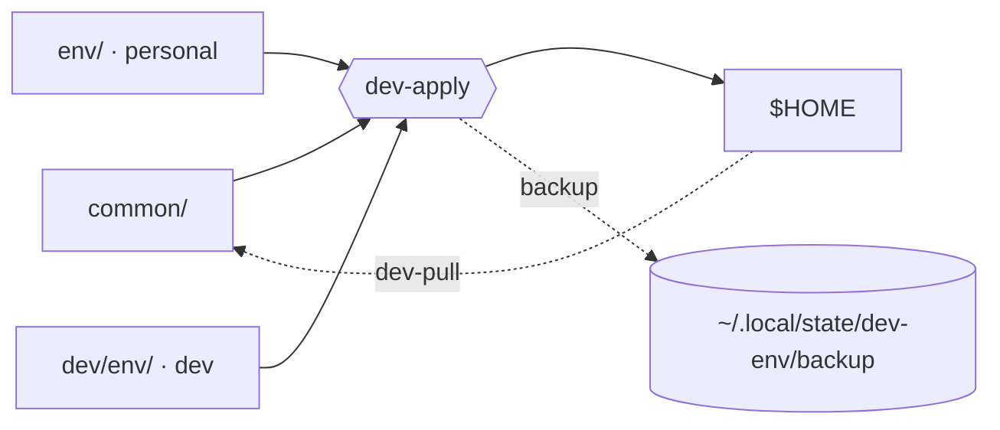

# .personal

My macOS dotfiles and machine setup, modelled on ThePrimeagen's
[dev](https://github.com/ThePrimeagen/dev), [init.lua](https://github.com/ThePrimeagen/init.lua) and
[tmux-sessionizer](https://github.com/ThePrimeagen/tmux-sessionizer).
Source: [MeetTak/primeageMultiEnvSetup](https://github.com/MeetTak/primeageMultiEnvSetup).

!!! tip "Find anything fast"
    Press **`/`** (or click the search box) and type a key, command or tool, e.g. `harpoon`, `prefix`,
    `Hyper`, `dev-pull`. Each section of the guide also has a ¶ link you can copy and share.

## Start here

| I want to… | Go to |
|---|---|
| Set up a new Mac | [Quick start](GUIDE.md#1-quick-start-new-mac) |
| Understand how it fits together | [The mental model](GUIDE.md#2-the-mental-model) · [Repository layout](GUIDE.md#3-repository-layout) |
| Know why it's built this way | [Specs](GUIDE.md#b-specs-the-rules-the-project-keeps) · [Design decisions](GUIDE.md#c-design-decisions-and-why) · [vs ThePrimeagen](GUIDE.md#d-compared-with-theprimeagens-setup) |
| Look up a command | [Command reference](GUIDE.md#5-command-reference) |
| Look up a key | [tmux](GUIDE.md#9-tmux-and-tmux-sessionizer) · [Neovim](GUIDE.md#10-neovim) · [Windows & keyboard](GUIDE.md#11-keyboard-and-window-management) |
| Do a common task | [Recipes](GUIDE.md#16-recipes) |
| Fix something | [Troubleshooting](GUIDE.md#17-troubleshooting) · [Known quirks](GUIDE.md#18-known-quirks) |
| See what's next | [Build history](GUIDE.md#e-build-history) · [Ideas and roadmap](GUIDE.md#f-ideas-and-roadmap) |

## At a glance

| Command | What it does |
|---|---|
| `dev-apply [--dry]` | Apply the current profile to `$HOME` (with backups) |
| `dev-on` / `dev-off` / `dev-status` | Switch to dev / switch to personal / show the profile |
| `dev-pull [--dry]` | Copy live edits back into the repo |
| `dev-commit` | Commit and push the repo (this site redeploys itself) |
| `./run [filter] [--dry]` | Run the installers in `runs/` |
| `tests/run [filter]` | Run the test suite |
| `Ctrl-F` | Fuzzy-jump to a project's tmux session |
